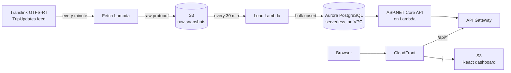

# SEQ Transit Reliability

How punctual is public transport in South East Queensland, route by route? This project records
Translink's real-time feed every minute, works out how late each service actually was at every stop,
and publishes the results as a small dashboard and API.

Built with C# / .NET 10, ASP.NET Core, EF Core, PostgreSQL, React + TypeScript, and AWS
(Lambda, EventBridge Scheduler, S3, Aurora Serverless, API Gateway, CloudFront), deployed with the AWS CDK
and GitHub Actions.

> **Status:** starter. The core logic, SQL and infrastructure are tested (see [Tests](#tests)); the first
> run against the live feed and a real AWS account is the next step. Update this line as you go.

## How it works



1. **Fetch** (every minute) downloads the TripUpdates feed, checks it parses, and stores the raw bytes in S3
   under a key made from the feed's own timestamp. It never touches the database.
2. **Load** (every 30 minutes) reads every snapshot newer than the last one loaded, folds them into one row per
   trip stop (newest prediction wins), and writes them in a single transaction.
3. **API** answers read-only questions: on-time rate per route, daily trends, cancellations.
4. **Dashboard** shows the least punctual routes first.

A stop counts once the vehicle has passed it. On time means between 1 minute early and 5 minutes late
(configurable in `OnTime` settings).

## Design decisions

Short versions; the reasoning and trade-offs are in [docs/decisions.md](docs/decisions.md).

- **No VPC, no NAT gateway.** The database is an Aurora PostgreSQL cluster created with *express configuration*:
  it is reached through Aurora's internet access gateway with IAM sign-in, so the Lambda functions don't need a
  VPC and the stack avoids the usual NAT gateway bill.
- **Raw snapshots first, database in batches.** Every minute only touches S3. Loading in batches lets Aurora
  Serverless pause between loads, and the stored snapshots can be replayed if the loading logic changes.
- **Idempotent loading.** Snapshots are keyed by feed timestamp, the watermark lives in the database, each batch
  is one transaction, and an upsert never lets older data overwrite newer data. Re-running a load is always safe.
- **One bulk statement per batch.** Each column is sent as an array and expanded with `unnest`, so tens of
  thousands of rows are written in one round trip.
- **No passwords.** Lambda functions sign in to the database with short-lived IAM tokens, as least-privilege
  roles (`seq_ingest` writes, `seq_api` only reads).
- **Cost guards in code.** API throttling, a 60-second CloudFront cache on `/api/*`, snapshot expiry, and an
  AWS Budgets alert are all part of the stack.

## Repository layout

| Path | What it is |
| --- | --- |
| `src/SeqTransit.Core` | GTFS-RT parsing, folding snapshots, punctuality rules, fetch/load workflows. No AWS or database code. |
| `src/SeqTransit.Data` | PostgreSQL access: IAM sign-in, bulk upserts, EF Core read queries, migration runner. |
| `src/SeqTransit.Ingestion` | The fetch and load Lambda functions (S3 adapter). |
| `src/SeqTransit.Api` | ASP.NET Core minimal API; runs on Kestrel locally and on Lambda in AWS. |
| `src/SeqTransit.Migrator` | Applies `db/migrations/*.sql`. |
| `src/SeqTransit.Local` | Runs fetch and load on your machine against Docker Postgres. |
| `db/migrations` | The schema, as plain SQL. |
| `proto` | The official GTFS-realtime protobuf definition (Apache 2.0). |
| `infra` | AWS CDK app (TypeScript) and its tests. |
| `web` | React + TypeScript dashboard (Vite). |
| `scripts` | Build and setup scripts (PowerShell and bash). |

## Run it locally

You need the [.NET 10 SDK](https://dotnet.microsoft.com/download), Node.js 22 or later, and Docker Desktop.

```powershell
# 1. Start PostgreSQL
docker compose up -d

# 2. Create the tables
$env:DB_CONNECTION_STRING = "Host=localhost;Database=seq_transit;Username=postgres;Password=postgres"
dotnet run --project src/SeqTransit.Migrator

# 3. Collect real data: fetches every minute, loads every 5 minutes (leave it running)
dotnet run --project src/SeqTransit.Local -- run

# 4. In a second terminal: the API on http://localhost:5080
dotnet run --project src/SeqTransit.Api

# 5. In a third terminal: the dashboard on http://localhost:5173
cd web
npm install
npm run dev
```

On macOS or Linux, set the variable with `export DB_CONNECTION_STRING=...` instead.
To work on the dashboard without any data, open <http://localhost:5173/?sample>.

## Tests

```powershell
dotnet test                                           # everything; the database tests need Docker running
dotnet test --filter "Category!=Integration"          # without Docker
cd infra; npm test                                    # CDK stack assertions
```

- `SeqTransit.Core.Tests`: feed parsing, snapshot folding, retries, batching, idempotent reloads.
- `SeqTransit.Data.Tests`: migrations, upserts and EF Core queries against real PostgreSQL (Testcontainers).
- `infra/test`: no VPC or NAT gateway, .NET 10 on arm64, schedules, database permissions limited to the app
  roles, private buckets, API throttling, alarms and budget, GitHub role restricted to `main`.

## Deploy to AWS

You need a recent AWS CLI v2 (one that knows `--with-express-configuration`), credentials for your account, and
the CDK bootstrapped once in the region: `cd infra; npm ci; npx cdk bootstrap`.

```powershell
# 1. Create the database (prints dbHost and dbClusterResourceId)
./scripts/create-database.ps1

# 2. Copy infra/cdk.context.example.json to infra/cdk.context.json and fill it in
#    (it is git-ignored, so your email and endpoint stay out of the repository)

# 3. Create the tables and roles, signing in as the admin user with IAM
$env:DB_CONNECTION_STRING = $null
$env:DB_HOST = "<dbHost>"; $env:DB_USER = "postgres"; $env:AWS_REGION = "ap-southeast-2"
dotnet run --project src/SeqTransit.Migrator

# 4. Build and deploy
./scripts/publish.ps1
cd infra
npm run deploy
```

The deploy prints `SiteUrl` (the dashboard) and `ApiUrl`. If you set `alertEmail`, confirm the subscription
email from AWS so alarms and budget alerts reach you.

### Deploy from GitHub Actions

The workflow in `.github/workflows/ci.yml` builds and tests every push, and deploys `main` once you set it up:

1. Set `githubRepository` in `infra/cdk.context.json`, then run `cd infra; npm run deploy:github`. It creates
   an IAM role that only GitHub Actions on `main` of that repository can use, with no stored access keys.
2. In the repository settings, add these **variables**: `AWS_DEPLOY_ROLE_ARN` (from the output of step 1),
   `SEQ_DB_HOST`, `SEQ_DB_CLUSTER_RESOURCE_ID`, and optionally `SEQ_ALERT_EMAIL`.

### Costs and clean-up

The expensive part is Aurora while it is awake. The load interval (`loadIntervalMinutes`, default 30) and the
cluster's auto-pause setting decide how much of the day it sleeps; [docs/decisions.md](docs/decisions.md)
walks through the trade-off. Lambda, S3, API Gateway and CloudFront usage at this scale is small. Check
current prices for `ap-southeast-2`, and keep the budget alert on.

To remove everything: `cd infra; npm run destroy`, then delete the cluster with
`aws rds delete-db-cluster --db-cluster-identifier seq-transit --skip-final-snapshot`.

## Roadmap

- [ ] First run against the live feed: check feed size, how often the timestamp changes, and whether trips
      without a tracked vehicle report a delay of zero (they would inflate on-time rates).
- [ ] Load static GTFS (routes, stops, timetables) so the dashboard shows route names and stop names.
- [ ] Peak-hour and worst-stop views; charts for daily trends.
- [ ] Weekly plain-English summary with Amazon Bedrock.
- [ ] ReadyToRun builds for faster Lambda cold starts; OpenAPI document for the API.

## Data and licences

Real-time data from [Translink Open Data](https://translink.com.au/about-translink/open-data), licensed under
[CC BY 4.0](https://creativecommons.org/licenses/by/4.0/). This project is not affiliated with Translink.
`proto/gtfs-realtime.proto` is from [google/transit](https://github.com/google/transit) under the Apache 2.0
licence. Project code: MIT, see [LICENSE](LICENSE).
